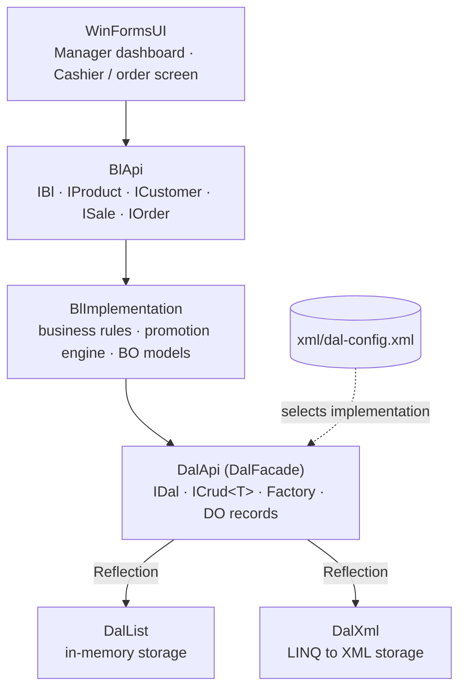

# Wine Shop Management System
 
A layered **C# / .NET 8** desktop application for running a wine & liquor shop: products, customers, promotions and a full checkout flow with automatic discount calculation.
Built around a strict **Three-Tier architecture** with interface-based layers and a **pluggable data-access layer** that is selected at runtime from a configuration file.
 


 
---
 
## Highlights
 
- **Three-Tier architecture** (DAL · BL · UI), each layer in its own project and accessed only through interfaces.
- **Pluggable DAL** – two interchangeable implementations (in-memory and XML). The active one is chosen in `xml/dal-config.xml` and loaded at runtime with **Factory + Reflection**, with no change to business logic.
- **Promotion engine** – finds active promotions for each order line, respects club-member-only deals, applies the most cost-effective one first and charges the remainder at the regular price.
- **Stock validation** on every change to an order and again at checkout.
- **Separate domain models per layer** – immutable `record` DOs in the DAL and BOs in the BL that carry computed state (final prices, applied promotions), with explicit converters between them.
- **Domain-level exceptions** – the BL defines its own exception types (entity not found, insufficient stock, invalid quantity) so the UI can handle errors in business terms.
- **Role-based UI** – manager dashboard for managing data, and a cashier screen for building and completing orders.
---
 
## Architecture
 

 
**Request flow:** the UI calls `BlApi.Factory.Get()` and talks only to BL interfaces. The BL calls `DalApi.Factory.Get`, which reads `dal-config.xml`, loads the configured DAL assembly with Reflection and returns its singleton instance as `IDal`. The BL maps the returned DOs to BOs, applies the business rules and returns BOs to the UI.
 
### Design decisions
 
| Decision | Why |
|---|---|
| Interfaces between every layer (`IBl`, `IDal`, `ICrud<T>`) | Layers depend on contracts, not implementations (Dependency Inversion) |
| Factory + Reflection for DAL loading | Replace the storage mechanism by editing a config file, without recompiling the BL or UI |
| Singleton DAL instances | One shared access point per data source |
| Generic `ICrud<T>` with `Func<T, bool>` filters | One consistent CRUD contract for all entities, with flexible LINQ-based querying |
| DO (`record`) vs. BO separation | Storage models stay simple and immutable; business models carry computed state such as final prices and applied promotions |
| Dedicated BL exception types | The UI handles business errors (missing entity, insufficient stock) and is not coupled to storage details |
| ID sequences in `data-config.xml` | Persistent auto-increment IDs for the XML implementation |
 
---
 
## Features
 
**Manager**
- Create, update and delete products, customers and promotions
- View all entities in data grids
**Cashier / order flow**
- Build an order, add products, change quantities or remove items
- Mark the customer as a club member to unlock member-only promotions
- Live recalculation of line prices and order total
- Complete the purchase, which validates stock and updates inventory
**Promotion engine (`OrderImplementation`)**
1. Find promotions that are active today, apply to the product and whose minimum quantity is met. Member-only promotions are included only for club members.
2. Sort them by price per unit, most cost-effective first.
3. Apply each promotion in full bundles of its required quantity.
4. Charge any remaining units at the regular price.
5. Store the final line price and the promotions applied, then recalculate the order total.
---
 
## Tech stack
 
- **Language / runtime:** C# 12, .NET 8
- **UI:** Windows Forms
- **Data access:** in-memory collections, LINQ to XML
- **Patterns:** Three-Tier, Factory, Singleton, DTO-style DO/BO mapping, Dependency Inversion
- **Other:** LINQ, Reflection, custom exception hierarchy
---
 
## Project structure
 
```
Wine-shop-project/
├── DalFacade/        # DAL contracts: IDal, ICrud<T>, entity interfaces, Factory, config loader, DO records
├── DalList/          # In-memory DAL implementation (with seed data)
├── DalXML/           # XML DAL implementation (LINQ to XML)
├── BL/
│   ├── BlApi/        # BL interfaces + Factory
│   ├── BlImplementation/  # Business logic, including the promotion engine
│   └── BO/           # Business objects, DO↔BO converters, BL exceptions
├── WinFormsUI/       # Desktop UI: role selection, manager dashboard, order screen
├── DalTest/          # Interactive console test harness for the DAL
├── BlTest/           # Interactive + automated console test harness for the BL
└── xml/              # dal-config.xml, data-config.xml and XML data files
```
 
---
 
## Getting started
 
### Prerequisites
- Windows (required for WinForms)
- [.NET 8 SDK](https://dotnet.microsoft.com/download/dotnet/8.0), or Visual Studio 2022
### Run
 
```bash
git clone https://github.com/Sara-Yaakov/Wine-shop-project.git
cd Wine-shop-project
dotnet build
 
# Desktop application
dotnet run --project WinFormsUI
 
# Business-logic test harness (automated scenario)
dotnet run --project BlTest -- autotest
```
 
### Switch the data source
 
Edit `xml/dal-config.xml` and set `<dal>` to `list` (in-memory) or `xml` (XML files):
 
```xml
<config>
  <dal>list</dal>
  <dal-packages>
    <list>DalList</list>
    <xml>DalXml</xml>
  </dal-packages>
</config>
```
 
---
 
## Testing
 
- **DalTest** – interactive console app for exercising CRUD operations directly against the DAL.
- **BlTest** – interactive menus for every entity and the order flow, plus an `autotest` mode that runs an end-to-end scenario: create a product, customer and promotion, build an order, apply the promotion, check out, verify the stock update and check edge cases such as over-ordering and removing items.
---
 
## Roadmap
 
- [ ] Replace the console harnesses with xUnit unit tests
- [ ] Expose the business layer through an ASP.NET Core Web API
- [ ] Add a SQL Server data layer with Entity Framework Core
---
 
## Authors
 
Developed together in pair programming by:
 
- **Sara Yaakov** – [@Sara-Yaakov](https://github.com/Sara-Yaakov)
- **Bracha Lubling**
Built as a project in the .NET course in the Practical Software Engineering program (2026).
 
